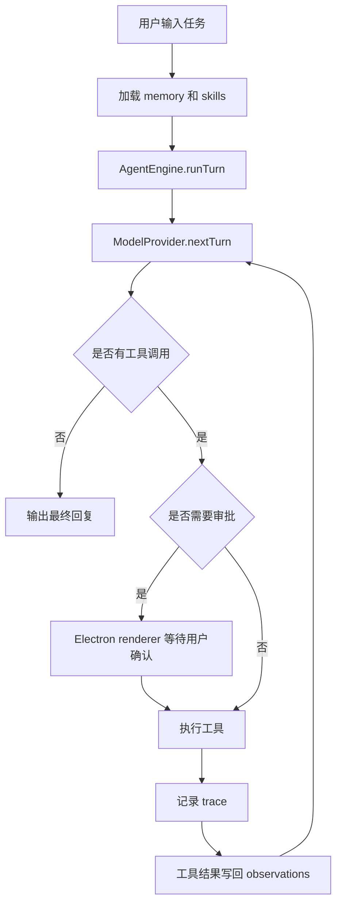

# Reina Agent 设计

Reina 是一个 Electron 桌面端 AI 编码 Agent。Renderer 通过 IPC 与 main process 通信，main 直接持有 `AgentEngine` 与所有工具能力。

## 设计目标

- 用户在本地 workspace 里让 Agent 读文件、搜索、执行命令和修改文件。
- 危险工具默认需要审批，用户保留控制权。
- 核心能力（engine / providers / tools）不依赖任何 UI 框架，只负责状态与执行。
- 同时支持 OpenAI-compatible 和 Claude 两类模型协议，并可接入 KIMI/DeepSeek 等任意 OpenAI 兼容端点。
- API key 直接保存到本地配置文件，不强制走 shell 环境变量。

## 分层

```text
apps/desktop
  Electron 应用。Main 进程通过 stdio 子进程加载 @reina/agent-host，并向 renderer 推送事件。

packages/agent-host
  Long-running Node 进程：解码 desktop 请求，驱动 AgentEngine，回传事件流。

packages/core
  AgentEngine、profile、审批、会话状态、模型循环、skills、memory、trace、hooks。

packages/providers
  deterministic、OpenAI Responses、OpenAI Chat Completions、Anthropic Messages。

packages/tools
  本地工具运行时：文件、搜索、shell、git、diff、memory、MCP。

packages/protocol
  共享类型和 zod schema。

packages/desktop-protocol
  Renderer 与 agent-host 之间的请求/事件 schema。
```

## Agent Loop



## Profile

内置 profile：

- `build`：默认开发 Agent，可以读写文件并执行必要命令。
- `plan`：只读规划 Agent，不直接写文件或执行高风险命令。
- `explore`：只读探索 Agent，用于理解项目结构。
- `general`：通用 Agent，用于 `task` 子任务。
- `summary`：总结 Agent，用于上下文压缩。

用户可在 Settings → Subagents 自定义额外的 profile，保存到 `~/.reina/agents.json` 后通过 `/task <name>` 调用。

## Reina 风格能力

已吸收：

- Skills：从 `.reina/skills/<name>/SKILL.md` 加载元数据，prompt 只暴露名称、描述和路径，需要时再读取完整说明。
- Memory：始终加载 `AGENTS.md`。
- Subagent：`task` 工具启动短生命周期子 Agent，隔离上下文，只回传最终结果。
- Summarization：运行时自动压缩或用户 `/compact` 将旧消息压缩到 `session.summary`，不提供模型可调用的压缩工具。
- Permission：工具权限和审批策略独立于工具实现。
- Hooks：preToolUse / postToolUse / userPromptSubmit / onStop 跨平台 shell 钩子。

暂不照搬：

- LangGraph middleware 栈。
- 远程 backend/store。
- 异步并行 subagent 调度器。

## 桌面端通信

Renderer ↔ main ↔ agent-host 走以下通道：

- Renderer → main：`reina:invoke` IPC，generic command 转发。
- Main → agent-host：JSON-line over stdio。
- Agent-host → main：JSON-line events（model_stream、turn_started/completed/failed、permission_request、question_request、session_snapshot）。
- Main → renderer：`reina:event:agent` IPC 广播。

API key 保存于 `~/.reina/models.json`，可选 fallback 到 shell 环境变量。Renderer 永远不直接持有密钥；密钥随 `create_session` 一并发到 agent-host，由 provider 在调用时使用。
